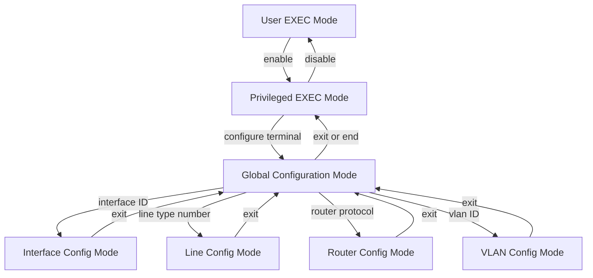

# Cisco IOS CLI — Complete Reference Notes

## Table of Contents
- [What Is Cisco IOS](#what-is-cisco-ios)
- [Accessing the Device](#accessing-the-device)
- [The CLI Mode Hierarchy](#the-cli-mode-hierarchy)
- [Privilege Levels and the Security Model](#privilege-levels-and-the-security-model)
- [Navigating and Editing the CLI](#navigating-and-editing-the-cli)
- [Command Syntax Conventions](#command-syntax-conventions)
- [Initial Device Configuration](#initial-device-configuration)
- [Interface Configuration](#interface-configuration)
- [Essential Show Commands](#essential-show-commands)
- [Saving and Managing Configuration](#saving-and-managing-configuration)
- [The IOS File System and Device Memory](#the-ios-file-system-and-device-memory)
- [VLANs and Switching Basics](#vlans-and-switching-basics)
- [Basic Routing](#basic-routing)
- [Access Control Lists](#access-control-lists)
- [Troubleshooting and Diagnostics](#troubleshooting-and-diagnostics)
- [Common Mistakes and Gotchas](#common-mistakes-and-gotchas)
- [Quick Reference Cheat Sheet](#quick-reference-cheat-sheet)
- [Glossary](#glossary)
- [Where to Go Next](#where-to-go-next)

---

## What Is Cisco IOS

**Cisco IOS** (Internetwork Operating System) is the software that runs on most Cisco routers and Catalyst switches. It handles everything the device does — routing, switching, security, QoS, monitoring — and it's controlled almost entirely through a text-based **command-line interface (CLI)**, not a GUI. Understanding the CLI *is* understanding how to run a Cisco device.

### Why a CLI, and why this structure
The CLI is deliberately:
- **Hierarchical** — commands are scoped to "modes," so you can only run interface commands while inside interface context, routing commands while inside router context, etc. This prevents accidental changes and keeps command sets manageable.
- **Privilege-gated** — read-only monitoring is separated from configuration, which is separated from full administrative control.
- **Terse and scriptable** — short, consistent verbs (`show`, `no`, `copy`, `debug`) that compose predictably, which is why CLI configs can be pasted, templated, and automated.

### IOS family at a glance
| Variant           | Runs On                                              | Notes                                                                                 |
| ----------------- | ---------------------------------------------------- | ------------------------------------------------------------------------------------- |
| **IOS (classic)** | Older/smaller routers and switches                   | Monolithic image; the "traditional" CLI everyone learns first                         |
| **IOS-XE**        | Modern platforms (Catalyst 9000, ISR 4000, ASR 1000) | Linux-based underneath, but the CLI you type is nearly identical to classic IOS       |
| **IOS-XR**        | Service-provider grade routers (ASR 9000, NCS)       | Modular, different architecture; CLI *philosophy* is similar but many commands differ |
| **NX-OS**         | Nexus data-center switches                           | Borrowed IOS-style CLI conventions but is a separate OS with its own command set      |

Everything below applies to **IOS and IOS-XE**, which is what "Cisco CLI" means in the vast majority of real-world and certification contexts.

---

## Accessing the Device

| Method | In-band / Out-of-band | Notes |
|---|---|---|
| **Console port** | Out-of-band | Physical rollover or USB console cable direct to the device. Works even if the network/IP stack is completely broken — this is your "break glass" access method. |
| **SSH** | In-band | Encrypted remote access over the network. The modern standard for remote management. |
| **Telnet** | In-band | Unencrypted remote access — legacy and insecure (credentials and traffic sent in plaintext). Avoid on production networks. |
| **AUX port** | Out-of-band | Legacy async port, historically used for modem dial-up remote access. Rare today. |

> [!tip] Console terminal settings
> When connecting via console, your terminal emulator (PuTTY, SecureCRT, Tera Term, screen) needs: **9600 baud, 8 data bits, no parity, 1 stop bit, no flow control** — often shorthanded as "9600 8N1."

---

## The CLI Mode Hierarchy

This is the single most important concept for understanding "how the CLI works." Every command you type is only valid in specific **modes**, and the modes nest inside each other like folders.



### The modes

| Mode | Example Prompt | How to Enter | Purpose |
|---|---|---|---|
| **User EXEC** | `Router>` | Default on login | Very limited — basic monitoring only (e.g. `ping`, some `show` commands) |
| **Privileged EXEC** | `Router#` | `enable` from User EXEC | Full visibility: all `show`, `debug`, `clear` commands — but **no configuration changes** yet |
| **Global Configuration** | `Router(config)#` | `configure terminal` from Privileged EXEC | Device-wide settings: hostname, banners, global features |
| **Interface Config** | `Router(config-if)#` | `interface <type><number>` | Settings for one specific interface (IP address, speed, switchport mode) |
| **Subinterface Config** | `Router(config-subif)#` | `interface <type><#>.<subif#>` | Logical sub-interface, e.g. router-on-a-stick VLAN routing |
| **Line Config** | `Router(config-line)#` | `line console 0` / `line vty 0 4` / `line aux 0` | Console/Telnet/SSH/AUX access settings (passwords, timeouts) |
| **Router Config** | `Router(config-router)#` | `router ospf 1` / `router eigrp 100` / `router rip` | Settings for a specific routing protocol |
| **VLAN Config** | `Router(config-vlan)#` | `vlan 10` | Defines a VLAN (on switches) |
| **Named ACL Config** | `Router(config-ext-nacl)#` | `ip access-list extended NAME` | Building a named access list line by line |

### Moving between modes
- `enable` — User EXEC → Privileged EXEC (may prompt for a password)
- `disable` — Privileged EXEC → User EXEC
- `configure terminal` (or `conf t`) — Privileged EXEC → Global Config
- `exit` — moves **up exactly one level** (or logs out if you're already at the top)
- `end` — jumps **directly back to Privileged EXEC** from any config sub-mode, no matter how deep you are
- **Ctrl+Z** — identical shortcut for `end`

> [!note]
> You can always tell your exact location from the prompt itself: `Router>` vs `Router#` vs `Router(config)#` vs `Router(config-if)#`. Get fluent at reading prompts — it's how you avoid running a command in the wrong context.

---

## Privilege Levels and the Security Model

IOS supports **16 privilege levels**, numbered 0–15:
- **Level 0** — Just 5 commands (`logout`, `enable`, `disable`, `help`, some others) — rarely used
- **Level 1** — User EXEC (the default unprivileged level)
- **Level 15** — Privileged EXEC — full access

Custom privilege levels (2–14) can be configured to grant a user rights to specific commands without giving them full admin (`privilege exec level 5 show running-config`, for example) — useful for tiered help-desk access.

At enterprise scale, local usernames don't scale well, so IOS supports **AAA (Authentication, Authorization, Accounting)** against centralized servers using **TACACS+** or **RADIUS**. AAA is a large topic on its own (see [Where to Go Next](#where-to-go-next)), but it's worth knowing it exists as the natural evolution beyond local passwords.

---

## Navigating and Editing the CLI

### Help and completion
- **Tab** — completes a partially typed command if it's unambiguous
- **`?`** (alone) — lists every command available in the current mode
- **`he?`** (no space) — lists commands starting with "he"
- **`command ?`** (with space) — lists the valid next keywords/parameters
- **Abbreviation** — commands can be shortened to the shortest unambiguous prefix: `conf t` = `configure terminal`, `sh run` = `show running-config`, `int gi0/0` = `interface gigabitEthernet0/0`

Example of the help system in action:
```
Router#show ip ?
  access-lists  List IP access lists
  arp           IP ARP table
  interface     IP interface status and configuration
  ospf          OSPF state information
  protocols     IP routing protocol process parameters
  route         IP routing table
```

### Command history
- **Ctrl+P** / **↑** — recall the previous command
- **Ctrl+N** / **↓** — recall the next (more recent) command
- `show history` — display the history buffer
- `terminal history size <n>` — change buffer size (default 10, max 256)

### Editing shortcuts
| Shortcut | Action |
|---|---|
| **Tab** | Complete a partially typed command |
| **?** | Context-sensitive help |
| **Ctrl+A** | Move cursor to the beginning of the line |
| **Ctrl+E** | Move cursor to the end of the line |
| **Ctrl+B** / **←** | Move back one character |
| **Ctrl+F** / **→** | Move forward one character |
| **Esc, B** | Move back one word |
| **Esc, F** | Move forward one word |
| **Ctrl+W** | Delete the word to the left of the cursor |
| **Ctrl+U** | Erase the entire line |
| **Ctrl+K** | Delete from cursor to end of line |
| **Ctrl+D** | Delete the character under the cursor |
| **Ctrl+R** | Redisplay the current line (handy when a log message interrupts your typing) |
| **Ctrl+Shift+6** | Break/interrupt a running process (a stuck `ping`, `traceroute`, or DNS lookup hang) |
| **Ctrl+Z** | Exit config mode entirely, return to Privileged EXEC (same as `end`) |

> [!tip] Stop output paging
> By default, output pauses after 24 lines with `--More--`. Run `terminal length 0` in Privileged EXEC to disable paging entirely — essential when dumping a long `show running-config` or `show tech-support`.

---

## Command Syntax Conventions

The general pattern is: **`[no] verb feature [parameters]`**

- **`no`** — negates, removes, or disables. `no shutdown` *enables* an interface (removes the "shutdown" state). `no ip domain-lookup` disables DNS lookups.
- **`default`** — resets a command/interface back to its factory default, e.g. `default interface gi0/0`.
- **`do`** — lets you run a Privileged EXEC command (like a `show`) from *any* config mode without leaving it. From `(config-if)#` you can type `do show ip interface brief`.

### Filtering output (the pipe)
| Filter | Effect |
|---|---|
| `\| include <string>` | Only show lines containing `<string>` |
| `\| exclude <string>` | Hide lines containing `<string>` |
| `\| begin <string>` | Show output starting from the first matching line |
| `\| section <string>` | Show the whole config block that starts with the matching line |
| `\| redirect <location>` | Send output to a file instead of the screen |
| `\| append <location>` | Append output to an existing file |

```
show running-config | section interface GigabitEthernet0/1
show ip route | include 0.0.0.0
show run | begin line vty
```

These filters accept basic regular expressions, e.g. `show run | include ^interface` matches lines that *start* with "interface."

---

## Initial Device Configuration

### Hostname
```
hostname R1
```

### Banners
Shown at different points in the login sequence — `motd` before login, `login` at the login prompt, `exec` after successful login:
```
banner motd #Unauthorized access is prohibited. All activity is logged.#
banner login #Authorized users only.#
```
The `#` is just a delimiter character — pick any character not used inside the message itself.

### Passwords and secrets
| Command | Applies To | Notes |
|---|---|---|
| `enable password <pw>` | Privileged EXEC access | Legacy, weak/reversible protection — avoid |
| `enable secret <pw>` | Privileged EXEC access | Hashed (not reversible); **always wins** if both are configured |
| `service password-encryption` | Plaintext passwords in the config | Applies weak, reversible **Type 7** obfuscation — better than nothing, not real security |

```
enable secret MyStrongPass123!
service password-encryption
```

### Local user accounts
```
username admin privilege 15 secret MyStrongPass123!
```
Combine with `login local` on console/vty lines to require a username *and* password rather than a shared line password.

### Line (console / vty / aux) configuration
```
line console 0
 password ConsolePass
 login
 exec-timeout 10 0
 logging synchronous

line vty 0 4
 login local
 transport input ssh
 exec-timeout 5 0
```
- `login` requires a password; without it, a `password` alone under a line is **not enforced**.
- `exec-timeout <min> <sec>` sets the idle session timeout (default 10 minutes).
- `logging synchronous` stops unsolicited log/debug messages from garbling the line you're currently typing.
- `transport input ssh` restricts remote access to SSH only (blocks Telnet).

### Enabling SSH
1. `hostname R1` (required for key generation)
2. `ip domain-name example.com` (required for key generation)
3. `crypto key generate rsa` → choose a modulus (2048-bit or higher recommended)
4. `ip ssh version 2` (explicitly enforce SSHv2)
5. Under `line vty 0 4`: `transport input ssh` and `login local`

### Time and logging
```
service timestamps log datetime msec
ntp server 192.0.2.1
logging host 192.0.2.10
logging buffered 16384
```
Accurate timestamps matter enormously once you're correlating logs across multiple devices — NTP is not optional in a real network.

---

## Interface Configuration

### Naming conventions
Interfaces are named by physical type + slot/module/port:

| Abbreviation | Full Name |
|---|---|
| `Fa` | FastEthernet (100 Mbps, legacy) |
| `Gi` | GigabitEthernet (1 Gbps) |
| `Te` | TenGigabitEthernet (10 Gbps) |
| `Se` | Serial (WAN links) |
| `Lo` | Loopback (virtual, always up while the device is up) |
| `Tu` | Tunnel (virtual, for GRE/IPsec etc.) |
| `Vl` | Vlan (SVI — Switch Virtual Interface, Layer 3 gateway for a VLAN) |

### Basic interface config
```
interface GigabitEthernet0/1
 description Link to Core Switch
 ip address 192.168.1.1 255.255.255.0
 no shutdown
```

> [!warning] Interfaces default to shut down
> Most router interfaces are administratively **shut down out of the box**. If you've configured an IP address and nothing works, check `no shutdown` first — it's the single most common beginner miss.

### Speed and duplex
```
interface GigabitEthernet0/1
 speed 1000
 duplex full
```
Or leave both on `auto` (the default) to let the interfaces negotiate.

### Switchport (Layer 2) configuration
```
interface GigabitEthernet0/1
 switchport mode access
 switchport access vlan 10

interface GigabitEthernet0/2
 switchport mode trunk
 switchport trunk allowed vlan 10,20,30
 switchport trunk native vlan 99
```

### Configuring many interfaces at once
```
interface range GigabitEthernet0/1 - 24
 switchport mode access
 switchport access vlan 10
```

### Subinterfaces (router-on-a-stick)
```
interface GigabitEthernet0/0.10
 encapsulation dot1Q 10
 ip address 192.168.10.1 255.255.255.0
```

---

## Essential Show Commands

| Command | What It Shows |
|---|---|
| `show running-config` (`sh run`) | The active configuration currently running in RAM |
| `show startup-config` (`sh start`) | The configuration saved in NVRAM, loaded at next boot |
| `show version` (`sh ver`) | IOS version, uptime, hardware, config register value |
| `show ip interface brief` (`sh ip int br`) | Quick summary of every interface: IP, status, protocol |
| `show interfaces` (`sh int`) | Detailed per-interface stats: errors, drops, duplex, bandwidth |
| `show ip route` | The IP routing table |
| `show cdp neighbors [detail]` | Directly-connected Cisco devices, via CDP |
| `show mac address-table` | Learned MAC-to-port mappings on a switch |
| `show vlan brief` | VLANs and which ports belong to each |
| `show arp` | The ARP cache (IP-to-MAC mappings) |
| `show processes cpu` | CPU usage broken down by process |
| `show flash` | Contents and free space of flash memory |
| `show clock` | Current system date/time |
| `show users` | Who is currently logged into the device |
| `show ip protocols` | Summary of active routing protocols |
| `show spanning-tree` | STP state per VLAN/interface |
| `show logging` | The local system log buffer |

### Reading `show ip interface brief`
```
Router#show ip interface brief
Interface              IP-Address      OK? Method Status                Protocol
GigabitEthernet0/0     192.168.1.1     YES manual up                    up
GigabitEthernet0/1     unassigned      YES unset  administratively down down
Vlan1                  unassigned      YES unset  administratively down down
```

> [!important] Interpreting Status/Protocol
> This pair is one of the most useful troubleshooting signals in IOS:
>
> | Status | Protocol | Meaning |
> |---|---|---|
> | `up` | `up` | Fully operational |
> | `administratively down` | `down` | Someone ran `shutdown` on it |
> | `down` | `down` | Physical (Layer 1) problem — cable, SFP, remote end powered off |
> | `up` | `down` | Layer 1 fine, Layer 2 problem — encapsulation mismatch, missing keepalives |

### Reading `show ip route`
```
Codes: L - local, C - connected, S - static, R - RIP, O - OSPF, D - EIGRP, B - BGP

      10.0.0.0/8 is variably subnetted, 2 subnets, 2 masks
C        10.0.0.0/24 is directly connected, GigabitEthernet0/0
L        10.0.0.1/32 is directly connected, GigabitEthernet0/0
S*    0.0.0.0/0 [1/0] via 10.0.0.254
```
`D` for EIGRP isn't a typo — it stands for **DUAL** (Diffusing Update Algorithm), EIGRP's underlying algorithm. `*` marks a candidate default route.

### Reading `show cdp neighbors`
```
Device ID        Local Intrfce     Holdtme    Capability  Platform  Port ID
SW1               Gig 0/1           178        S I         WS-C2960  Gig 0/1
```

---

## Saving and Managing Configuration

### The core concept
- **`running-config`** lives in **RAM** — it's the *active* configuration. Changes to it take effect **immediately**, the instant you press Enter.
- **`startup-config`** lives in **NVRAM** — it's what gets loaded when the device boots.

If you don't explicitly copy running → startup, a reload or power loss **discards every change you've made.**

| Command | Effect |
|---|---|
| `copy running-config startup-config` (`copy run start`, or older `write memory` / `wr`) | Save current config so it survives a reload |
| `copy startup-config running-config` | Merge startup-config into running-config (rarely what you actually want) |
| `write erase` / `erase startup-config` | Wipe the saved config — device boots to defaults next reload |
| `reload` | Restart the device |
| `show archive` / `configure replace` | IOS's built-in config versioning/rollback feature |

```
Router#copy running-config startup-config
Destination filename [startup-config]?
Building configuration...
[OK]
```

---

## The IOS File System and Device Memory

| Memory | Volatile? | Stores |
|---|---|---|
| **ROM** | No | Bootstrap program and a mini-IOS (ROMmon) used for recovery |
| **Flash** | No | The IOS image file(s) — equivalent to a hard drive |
| **NVRAM** | No | `startup-config` |
| **RAM** | **Yes** | `running-config`, routing tables, buffers — wiped on reboot |

### File management commands
```
dir flash:
show flash
copy tftp: flash:
copy flash: tftp:
copy running-config tftp:
boot system flash:c2900-universalk9-mz.SPA.155-3.M.bin
```
- `boot system` tells the device which specific IOS image to load, useful when flash holds more than one image.
- IOS image filenames encode platform, feature set, and version (e.g. `c2900-universalk9-mz.SPA.155-3.M.bin` = platform `c2900`, feature set `universalk9`, version `15.5(3)M`).

> [!note] Password recovery (brief)
> Recovery involves interrupting the boot sequence (Ctrl+Break) into ROMmon, changing the **configuration register** (`config-register 0x2142`) to skip loading `startup-config`, resetting the password, then restoring the register to its normal value (`0x2102`). This is standard, publicly documented Cisco procedure — worth knowing exists, not something to memorize step-by-step here.

---

## VLANs and Switching Basics

### Creating and assigning VLANs
```
vlan 10
 name SALES
exit

interface GigabitEthernet0/1
 switchport mode access
 switchport access vlan 10
```
`show vlan brief` confirms VLANs and their assigned ports.

### Trunking
```
interface GigabitEthernet0/2
 switchport mode trunk
 switchport trunk allowed vlan 10,20,30
 switchport trunk native vlan 99
```
- On older switches that support both ISL and 802.1Q, you may also need `switchport trunk encapsulation dot1q` — most modern switches are 802.1Q-only and skip this.
- The **native VLAN** carries untagged traffic on a trunk; it must match on both ends, and changing it away from the default (VLAN 1) is a common security hardening step.
- **DTP** (Dynamic Trunking Protocol) can auto-negotiate trunks (`dynamic auto` / `dynamic desirable`) — in production, most engineers hardcode `switchport mode trunk` or `access` explicitly instead, for predictability and security.

### VTP (VLAN Trunking Protocol)
Synchronizes the VLAN database across switches in a domain. Modes: **server**, **client**, **transparent**. A VTPv1/v2 misconfiguration can wipe VLANs domain-wide, which is why many networks run VTP in **transparent** mode (effectively off) deliberately.

### Spanning Tree Protocol (STP)
Prevents Layer 2 loops when redundant links exist between switches. `show spanning-tree` shows the current state (root bridge, port roles) per VLAN.

---

## Basic Routing

### Static routes
```
ip route 192.168.2.0 255.255.255.0 192.168.1.2
ip route 0.0.0.0 0.0.0.0 192.168.1.254
```
The second line is a **default route** ("gateway of last resort") — matches any destination not otherwise in the table.

### Dynamic routing protocols (enabling syntax only)
| Protocol | Type | Basic Config |
|---|---|---|
| **RIP** | Distance vector, hop-count metric, legacy | `router rip` → `version 2` → `network 192.168.1.0` |
| **EIGRP** | Advanced distance vector (Cisco) | `router eigrp 100` → `network 192.168.1.0 0.0.0.255` |
| **OSPF** | Link-state, area-based, widely deployed | `router ospf 1` → `network 192.168.1.0 0.0.0.255 area 0` |
| **BGP** | Path vector, internet/inter-AS scale | `router bgp 65001` → neighbor statements |

Each of these is a deep topic in its own right — this note covers only enough to recognize and enable them at the CLI. See [Where to Go Next](#where-to-go-next).

---

## Access Control Lists

| Type | Matches On | Number Range | Placement Best Practice |
|---|---|---|---|
| **Standard** | Source IP only | 1–99, 1300–1999 | Close to the **destination** |
| **Extended** | Source/destination IP, protocol, port | 100–199, 2000–2699 | Close to the **source** |
| **Named** | Same as standard/extended, but named instead of numbered | — | Easier to read and maintain |

```
access-list 10 permit 192.168.1.0 0.0.0.255
access-list 10 deny any

access-list 110 permit tcp 192.168.1.0 0.0.0.255 any eq 80
access-list 110 deny ip any any

ip access-list extended BLOCK_TELNET
 deny tcp any any eq 23
 permit ip any any
```

Applying an ACL:
```
interface GigabitEthernet0/1
 ip access-group 110 in

line vty 0 4
 access-class 10 in
```

> [!warning] Every ACL has an implicit deny
> If traffic doesn't match any `permit` line, it's dropped — even though you never typed a `deny` statement. This trips people up constantly.

**Wildcard masks** are the inverse of subnet masks: `0` means "must match," `1` means "don't care." `0.0.0.255` matches an entire /24. This is the opposite logic from a subnet mask and worth internalizing deliberately.

---

## Troubleshooting and Diagnostics

| Command | Use |
|---|---|
| `ping <ip>` | Basic Layer 3 connectivity test (ICMP echo) |
| `ping` (no arguments, Privileged EXEC) | **Extended ping** — prompts for source interface, repeat count, datagram size, etc. |
| `traceroute <ip>` | Shows the hop-by-hop path to a destination |
| `telnet <ip> <port>` | Quick Layer 7 service reachability test |
| `show cdp neighbors detail` | Detailed info on directly-connected Cisco gear |
| `show interfaces` | Check error counters, collisions, drops, duplex mismatches |
| `debug <feature>` | Real-time diagnostic logging (e.g. `debug ip packet`) |
| `undebug all` / `no debug all` | **Always** turn debugging back off — it's CPU-intensive |
| `terminal monitor` | Required to see debug/log output over a Telnet/SSH session (console sees it automatically) |
| `show logging` | Review the local log buffer |
| `show tech-support` | Massive diagnostic dump, typically gathered for a Cisco TAC case |

> [!danger] Debug carefully
> `debug` commands can generate enormous volumes of output and consume meaningful CPU — this has taken down production routers before. Use narrow, specific debugs, and always follow up with `undebug all`.

---

## Common Mistakes and Gotchas

1. **Forgetting `no shutdown`** — most interfaces ship administratively down; an IP address alone won't bring one up.
2. **Not saving before a reload** — unsaved `running-config` changes vanish completely on reload or power loss.
3. **`enable password` vs `enable secret`** — if both exist, `enable secret` always takes priority; `enable password` is legacy and weakly protected.
4. **A line `password` with no `login`** — the password won't actually be enforced unless `login` (or `login local`) is also set under that line.
5. **Mistyped commands hanging the session** — by default IOS tries to resolve an unrecognized word as a hostname via DNS, which can hang for ~30 seconds. Fix with `no ip domain-lookup`.
6. **Standard ACL placed too close to the source** — since it only matches source IP, placing it near the source can block far more than intended; standard ACLs generally belong close to the destination.
7. **Wildcard mask confusion** — the inverted logic versus subnet masks (`0` = match, `1` = ignore) trips up almost everyone at first.
8. **Native VLAN or allowed-VLAN mismatch on a trunk** — causes STP/security warnings and unpredictable behavior; both trunk ends must agree.
9. **Config changes are live, not staged** — unlike systems with a "commit" step, most IOS commands apply to `running-config` the instant you press Enter, including ones that can cut off your own remote session.
10. **Leaving Telnet enabled on vty lines** — the default (or `transport input telnet ssh`) still allows insecure Telnet unless you explicitly restrict to `transport input ssh`.

---

## Quick Reference Cheat Sheet

**Mode navigation**

| Command              | Effect                                |
| -------------------- | ------------------------------------- |
| `enable`             | User EXEC → Privileged EXEC           |
| `disable`            | Privileged EXEC → User EXEC           |
| `configure terminal` | Privileged EXEC → Global Config       |
| `exit`               | Up one level                          |
| `end` / Ctrl+Z       | Jump to Privileged EXEC from anywhere |

**Interfaces**

| Command                         | Effect                 |
| ------------------------------- | ---------------------- |
| `interface <type><#>`           | Enter interface config |
| `ip address <ip> <mask>`        | Assign an IP           |
| `no shutdown`                   | Enable the interface   |
| `description <text>`            | Label the interface    |
| `switchport mode access\|trunk` | Set Layer 2 port mode  |
| `switchport access vlan <#>`    | Assign access VLAN     |

**Saving and reloading**

| Command                              | Effect             |
| ------------------------------------ | ------------------ |
| `copy running-config startup-config` | Save config        |
| `write erase`                        | Wipe saved config  |
| `reload`                             | Restart device     |
| `show running-config`                | View active config |
| `show startup-config`                | View saved config  |

**Viewing status**

| Command                   | Effect                   |
| ------------------------- | ------------------------ |
| `show ip interface brief` | Interface/IP summary     |
| `show ip route`           | Routing table            |
| `show version`            | IOS/hardware/uptime info |
| `show cdp neighbors`      | Connected Cisco devices  |
| `show vlan brief`         | VLAN assignments         |

**Routing and ACLs**

| Command                               | Effect                    |
| ------------------------------------- | ------------------------- |
| `ip route <net> <mask> <next-hop>`    | Static route              |
| `ip route 0.0.0.0 0.0.0.0 <next-hop>` | Default route             |
| `access-list <#> permit\|deny <src>`  | Numbered ACL entry        |
| `ip access-group <#> in\|out`         | Apply ACL to an interface |

**Diagnostics**

| Command             | Effect                  |
| ------------------- | ----------------------- |
| `ping <ip>`         | Test connectivity       |
| `traceroute <ip>`   | Trace the path          |
| `debug <feature>`   | Live diagnostic logging |
| `undebug all`       | Stop all debugging      |
| `terminal length 0` | Disable output paging   |

---

## Glossary

- **IOS** — Internetwork Operating System; Cisco's device software
- **CLI** — Command-Line Interface
- **EXEC** — Execution mode (User or Privileged)
- **RAM** — Volatile memory holding `running-config`
- **NVRAM** — Non-volatile memory holding `startup-config`
- **Flash** — Non-volatile storage for the IOS image itself
- **ROM** — Read-only memory holding the bootstrap program and ROMmon
- **ROMmon** — ROM Monitor, a minimal recovery-mode OS
- **TFTP** — Trivial File Transfer Protocol, commonly used to move IOS images/configs
- **VLAN** — Virtual LAN, a logical broadcast domain
- **SVI** — Switch Virtual Interface, a Layer 3 interface representing a VLAN
- **ACL** — Access Control List, a traffic filter
- **VTP** — VLAN Trunking Protocol, synchronizes VLAN databases across switches
- **STP** — Spanning Tree Protocol, prevents Layer 2 loops
- **CDP** — Cisco Discovery Protocol (Cisco-proprietary neighbor discovery)
- **LLDP** — Link Layer Discovery Protocol (open-standard equivalent to CDP)
- **SSH / Telnet** — Remote access protocols (encrypted / plaintext respectively)
- **dot1Q (802.1Q)** — The VLAN tagging standard used on trunk links
- **DTP** — Dynamic Trunking Protocol, auto-negotiates trunk status
- **RIP / EIGRP / OSPF / BGP** — Dynamic routing protocols
- **DUAL** — Diffusing Update Algorithm, the algorithm behind EIGRP (hence route code "D")
- **AAA** — Authentication, Authorization, Accounting
- **TACACS+ / RADIUS** — Centralized AAA server protocols
- **MTU** — Maximum Transmission Unit, the largest packet size an interface will forward
- **HSRP** — Hot Standby Router Protocol, a Cisco gateway-redundancy protocol
- **Configuration register** — A 16-bit value controlling how the device boots (e.g. whether it loads `startup-config`)

---

