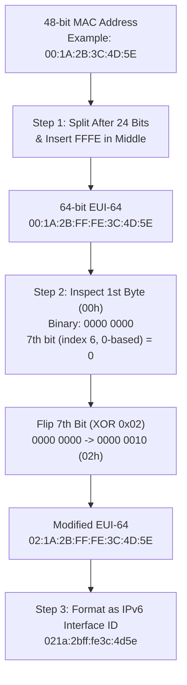

#networking 

__Internet Protocol Version 6__ is the most recent of [[IP]]. it functions much the same as IPv4 with a few new features. __IPv6__ is gaining more prominence as exhaustion with IPv4 becomes a real concern. 

- an IPv6 address is `128 bits`
- `::1` is the [[loopback address]]
- written in [[networking/base conversion|hexidecimal]]
- use the  `/` notation to denote the prefix length 

>[! shortening techniques]
> - leading `0's` can be removed 
> 	- a leading zero is any zero at the beginning of a quartet
> - consecutive quartets that contain all zeros can be written as `::`
> 	  - this can only be once 
> 	  - then only the leading zero's are removed 
> - `::` can also be used when write the host portion of a network in __IPv6__

 
 __IPv6__ is much the same as [[IP#IPv4|IPv4]] when it comes to prefixes. the convention is to use a `/64` prefix length though this is not always the case. if the prefix is a multiple of 4 then finding the host portion is trivial 

![[Pasted image 20261121172653.png]]

##### examples

###### ex. 1  `/56`

![[Pasted image 20261121172956.png]]

###### ex. 2 `/93`  

![[Pasted image 20261121173237.png]]


# address types 

## unicast 

- __global [[unicast]]__ __IPv6__ addresses are public addresses which can be used over the internet. they must be registered and globally unique. all addresses that are not reserved for other purposes are global addresses 
- __Unique local__ __IPv6__ addresses are private addresses that can not be used over the internet 
	- Uses the address block `FD00::/7`
	- the 48 bits that are not `FD` should be randomly generated and unique
- __Link Local__ __IPv6__ addresses are automatically generated on __IPv6__ enabled interfaces
	- uses the address block `FE80/10`
	- however the standard requires that the 54 bits after after the first ten should all be zero
	- then the interface ID is generated using EUI-64 rules 
	- routers will only be used with in a subnet 

## multicast 
__IPv6__ uses the range `FF00::/8` for [[Multicast]] addresses. _below are important multicast addresses_

| Purpose                                    | IPv6 Address | IPv4 Address |
| :----------------------------------------- | :----------- | :----------- |
| All nodes/hosts (functions like broadcast) | `FF02::1`    | `224.0.0.1`  |
| All routers                                | `FF02::2`    | `224.0.0.2`  |
| All OSPF routers                           | `FF02::5`    | `224.0.0.5`  |
| All OSPF DRs/BDRs                          | `FF02::6`    | `224.0.0.6`  |
| All RIP routers                            | `FF02::9`    | `224.0.0.9`  |
| All EIGRP routers                          | `FF02::A`    | `224.0.0.10` |
### scopes
__IPv6__ defines multiple multicast __scopes__ which denote how fare the packet should be forwarded 

**IPv6 multicast scopes:**
* **Interface-local** (`FF01`): The packet doesn’t leave the local device. Can be used to send traffic to a service within the local device.
* **Link-local** (`FF02`): The packet remains in the local subnet. Routers will not route the packet between subnets.
* **Site-local** (`FF05`): The packet can be forwarded by routers. Should be limited to a single physical location (not forwarded over a WAN).
* **Organization-local** (`FF08`): Wider in scope than site-local (an entire company/organization).
* **Global** (`FF0E`): No boundaries. Possible to be routed over the Internet.

## anycast
* Several routers share an identical IPv6 address.
  * Routing protocols announce this shared address across the network.
  * Traffic addressed to it is delivered to whichever matching router is closest according to routing metrics.
* No dedicated prefix is reserved for [[anycast]]; instead, standard unicast addresses (such as global unicast or unique local) are designated for anycast use.

## EUI-64

__EUI(Extended Unique Identifier)__ is a method of converiting a [[MAC]] address into a 64 bit interface identifier. This will become the host portion of a `/64` __IPv6__ address. 
_[info](https://networklessons.com/ipv6/ipv6-eui-64-explained)_
### convert the MAC 



# Cisco 
## configuring addresses 

```Cisco IOS
R1(config)#
R1(config)#ipv6 unicast-routing
R1(config)#int g0/0
R1(config-if)#ipv6 address 2001:db8:0:0::1/64
R1(config-if)#no shutdown
R1(config-if)#int g0/1
R1(config-if)#ipv6 address 2001:db8:0:1::1/64
R1(config-if)#no shutdown
R1(config-if)#int g0/2
R1(config-if)#ipv6 address 2001:0db8:0000:0002:0000:0000:0000:0001/64
R1(config-if)#no shutdown
R1(config-if)#show ipv6 interface breif 
```

### EUI-64
```cisco cli 
R1(config)# int g0/0
R1(config-if)# ipv6 address 2001:db8::/64 eui-64
R1(config-if)# no shutdown
```

### anycast 
```cisco cli 
R1(config-if)# ipv6 address ADDRESS anycast 
```