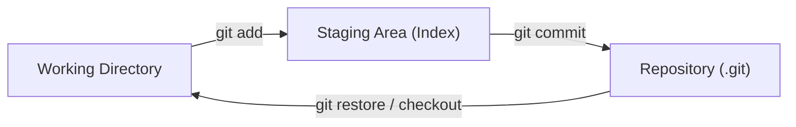
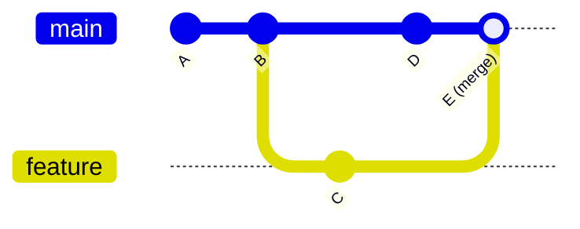
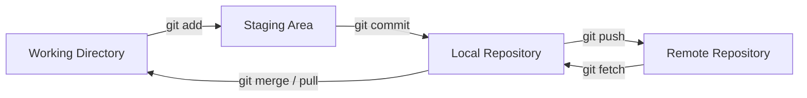

#clankerSlop


##  Part 1 — How Git Works

### What Is Git?

Git is a **distributed version control system (DVCS)**. A few ideas make it different from older tools like SVN:

- **Every clone is a full repository.** When you clone a project, you get the *entire history*, not just the latest files. There's no single "central" copy required to work.
- **Git stores snapshots, not diffs.** Each commit is a full snapshot of your project at that point in time (though Git is smart about storing unchanged files efficiently, so this isn't wasteful).
- **Almost everything is local.** Committing, branching, viewing history, diffing — none of it needs network access. Only `push`, `fetch`, `pull`, and `clone` talk to a remote.
- **Integrity by design.** Every object (file, folder, commit) is identified by a hash of its content. If a single byte changes anywhere in history, the hash changes too — so Git can always detect corruption or tampering.

### The Three Trees

Every file in a Git project moves through **three areas**:

| Area                           | What it is                                              |
| ------------------------------ | ------------------------------------------------------- |
| **Working Directory**          | The actual files on disk that you edit                  |
| **Staging Area (the "index")** | A draft/preview of what will go into your *next* commit |
| **Repository (`.git` folder)** | The permanent, committed history                        |




> [!tip] Why a staging area?
> The staging area lets you build a commit piece by piece — you can edit five files but only commit changes to two of them, or even stage half of a single file with `git add -p`.

### The Git Object Model

Under the hood, `.git` is just a content-addressed key-value database made of four object types:

| Object     | Purpose                                                                                         |
| ---------- | ----------------------------------------------------------------------------------------------- |
| **Blob**   | The raw content of a single file                                                                |
| **Tree**   | A directory listing — points to blobs (files) and other trees (subfolders)                      |
| **Commit** | A snapshot: points to one tree, one or more parent commits, plus author, date, and message      |
| **Tag**    | A friendly, permanent name pointing at a specific commit (annotated tags are stored as objects) |

Each object is named by the **SHA hash of its own content**. Identical content anywhere in the repo (even in different commits or files) is stored only once — this is what makes Git both fast and compact.

### Commits Form a Graph

Every commit points backward to its **parent commit(s)**:

- A normal commit has **one parent**.
- The very first commit has **zero parents**.
- A **merge commit** has **two or more parents** — it's where two lines of history join back together.

This chain of pointers forms a **Directed Acyclic Graph (DAG)** — this *is* your project's history.



### Branches Are Just Pointers

This is the single most important thing to understand about Git:

> [!success] Key insight
> A branch is **not** a copy of your files. It's just a small, movable pointer (a 41-byte text file) that points at one commit. That's why creating or switching branches in Git is nearly instant.

When you make a new commit while on a branch, Git simply moves that branch's pointer forward to the new commit. Nothing else needs to change.

### HEAD — Where You Are

`HEAD` is a pointer to *the branch you currently have checked out* (which in turn points to a commit). Most of the time `HEAD` → a branch name → a commit.

- Normal state: `HEAD` points to a branch (e.g. `main`), which points to a commit.
- **Detached HEAD**: `HEAD` points directly at a commit instead of a branch — this happens if you check out a specific commit or tag. Any new commits here can be "lost" unless you attach them to a branch.

### Remotes — Local vs Remote Repos

A "remote" is just **another Git repository** — often hosted on a service like GitHub or GitLab — that your local repo knows how to talk to.

- `origin` is the conventional name for the remote you cloned from (not a special keyword — just a default name).
- Git keeps read-only bookmarks for remote branches, like `origin/main`, showing where the remote branch was *as of your last fetch*.
- `push` uploads your commits to the remote; `fetch` downloads the remote's commits without touching your working files; `pull` = `fetch` + `merge` (or `rebase`) in one step.

### Putting It All Together



> [!question] Quick glossary
> | Term | Meaning |
> |---|---|
> | **Commit** | A saved snapshot with a unique ID |
> | **Branch** | A movable pointer to a commit |
> | **HEAD** | Pointer to your current branch/commit |
> | **Remote** | Another copy of the repo, usually on a server |
> | **Merge** | Combine two branches' histories |
> | **Rebase** | Replay commits onto a new base, rewriting history |
> | **Conflict** | Git can't auto-merge overlapping changes — you resolve manually |

---

## Part 2 — Cheat Sheet

> [!tip] How to read this
> Angle brackets `<>` mean "replace with your own value" — e.g. `<branch-name>` → `feature/login`.

### Setup & Configuration

| Command                                            | Description                             |
| -------------------------------------------------- | --------------------------------------- |
| `git config --global user.name "Name"`             | Set your name for commits               |
| `git config --global user.email "you@example.com"` | Set your email for commits              |
| `git config --global init.defaultBranch main`      | Set the default branch name             |
| `git config --list`                                | Show all current config settings        |
| `git init`                                         | Turn the current folder into a Git repo |

### Creating & Cloning

| Command                     | Description                                    |
| --------------------------- | ---------------------------------------------- |
| `git init`                  | Initialize a new, empty repository             |
| `git clone <url>`           | Copy a remote repo locally (with full history) |
| `git clone <url> <folder>`  | Clone into a custom folder name                |
| `git clone --depth 1 <url>` | Shallow clone — latest snapshot only, faster   |

### Everyday Snapshotting

| Command                    | Description                                    |
| -------------------------- | ---------------------------------------------- |
| `git status`               | See what's changed / staged                    |
| `git add <file>`           | Stage a specific file                          |
| `git add .`                | Stage everything in the current directory      |
| `git add -p`               | Stage changes interactively, chunk by chunk    |
| `git commit -m "message"`  | Commit staged changes                          |
| `git commit -am "message"` | Stage + commit all tracked changes in one step |
| `git diff`                 | Show unstaged changes                          |
| `git diff --staged`        | Show staged changes                            |
| `git rm <file>`            | Delete a file and stage the removal            |
| `git mv <old> <new>`       | Rename/move a file                             |

### Branching & Merging

| Command                      | Description                            |
| ---------------------------- | -------------------------------------- |
| `git branch`                 | List local branches                    |
| `git branch <name>`          | Create a new branch                    |
| `git switch <name>`          | Switch to a branch                     |
| `git switch -c <name>`       | Create and switch in one step          |
| `git branch -d <name>`       | Delete a branch (only if merged)       |
| `git branch -D <name>`       | Force-delete a branch                  |
| `git merge <branch>`         | Merge a branch into the current branch |
| `git merge --no-ff <branch>` | Merge but always create a merge commit |

### Undoing Things

> [!warning] Be careful
> `reset --hard` and force-pushing **rewrite history**. Avoid them on shared/public branches unless you're sure — and always double check with `git status` first.

| Command                       | Description                                                             |
| ----------------------------- | ----------------------------------------------------------------------- |
| `git restore <file>`          | Discard unstaged changes to a file                                      |
| `git restore --staged <file>` | Unstage a file (keeps the edits)                                        |
| `git commit --amend`          | Edit the most recent commit (message or content)                        |
| `git reset --soft HEAD~1`     | Undo last commit, keep changes staged                                   |
| `git reset --mixed HEAD~1`    | Undo last commit, keep changes unstaged *(default)*                     |
| `git reset --hard HEAD~1`     | Undo last commit, discard changes entirely                              |
| `git revert <commit>`         | Make a **new** commit that undoes a past one — safe for shared branches |

### Working with Remotes

| Command                       | Description                                     |
| ----------------------------- | ----------------------------------------------- |
| `git remote -v`               | List remotes and their URLs                     |
| `git remote add origin <url>` | Add a remote named `origin`                     |
| `git fetch`                   | Download remote changes without merging         |
| `git pull`                    | Fetch + merge into the current branch           |
| `git pull --rebase`           | Fetch + rebase instead of merge                 |
| `git push`                    | Upload local commits to the remote              |
| `git push -u origin <branch>` | Push and set the upstream tracking branch       |
| `git push --force-with-lease` | Safer force-push (fails if others pushed first) |

### Stashing

| Command           | Description                                       |
| ----------------- | ------------------------------------------------- |
| `git stash`       | Temporarily shelve uncommitted changes            |
| `git stash -u`    | Also stash untracked files                        |
| `git stash list`  | Show all saved stashes                            |
| `git stash pop`   | Reapply the latest stash and remove it            |
| `git stash apply` | Reapply the latest stash, but keep it in the list |
| `git stash drop`  | Delete a stash without applying it                |

### Inspecting History

| Command                           | Description                                |
| --------------------------------- | ------------------------------------------ |
| `git log`                         | Show commit history                        |
| `git log --oneline --graph --all` | Compact visual history across all branches |
| `git show <commit>`               | Show the details/diff of one commit        |
| `git blame <file>`                | Show who last changed each line            |
| `git diff <commit1> <commit2>`    | Compare two commits                        |

### Tags

| Command                          | Description              |
| -------------------------------- | ------------------------ |
| `git tag`                        | List all tags            |
| `git tag <name>`                 | Create a lightweight tag |
| `git tag -a <name> -m "message"` | Create an annotated tag  |
| `git push origin <tag>`          | Push a single tag        |
| `git push origin --tags`         | Push all tags            |

### Rebasing & History Rewriting

| Command                    | Description                                              |
| -------------------------- | -------------------------------------------------------- |
| `git rebase <branch>`      | Replay current branch's commits on top of another branch |
| `git rebase -i HEAD~3`     | Interactively edit/squash/reorder the last 3 commits     |
| `git rebase --continue`    | Continue after resolving a conflict                      |
| `git rebase --abort`       | Cancel the rebase, return to the pre-rebase state        |
| `git cherry-pick <commit>` | Apply one specific commit onto the current branch        |

### Useful Extras

| Command                            | Description                                                     |
| ---------------------------------- | --------------------------------------------------------------- |
| `git log -p <file>`                | Full history and diffs for a single file                        |
| `git shortlog -sn`                 | Contributors ranked by commit count                             |
| `git clean -fd`                    | Remove untracked files and folders                              |
| `git bisect start`                 | Binary-search through commits to find a bug                     |
| `git worktree add <path> <branch>` | Check out a branch into a second folder                         |
| `git reflog`                       | Log of everywhere `HEAD` has pointed — a lifesaver for recovery |

> [!success] Golden rule
> Think you've lost work? Check `git reflog` first. Git almost never truly deletes a commit right away — it just stops pointing at it.

> [!example] A typical day
> ```bash
> git pull
> git switch -c feature/my-thing
> # ...edit files...
> git add .
> git commit -m "Add my thing"
> git push -u origin feature/my-thing
> # open a Pull Request
> ```